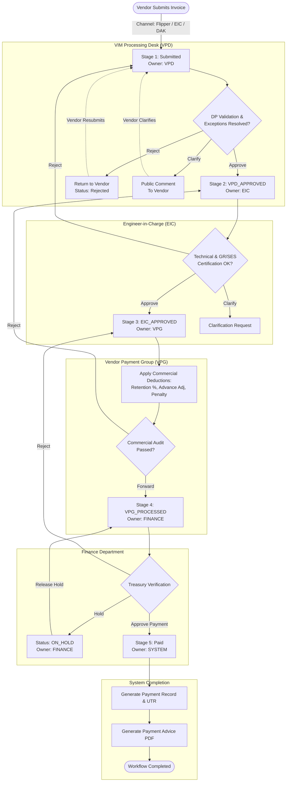

# NTPC-VIMS: Vendor Invoice Management System

[](https://nodejs.org/)
[](https://expressjs.com/)
[](https://react.dev/)
[](https://vitejs.dev/)
[](https://ant.design/)
[](https://www.mongodb.com/)
[](https://socket.io/)
[](http://localhost:5001/api-docs)

> **Enterprise SAP-Integrated Invoice Management & Workflow Simulation Platform**  
> Inspired by the operational workflows of **NTPC Limited** (India's largest power utility), simulating the **NTPC Flipper Vendor Portal** (`ebillpravesh.ntpc.co.in/flipper`) and back-end **OpenText SAP VIM (Vendor Invoice Management) 7.6 SPS7** (`/OPT/VIM_WP` & `/OPT/VIM_VA2`).

---

## 📋 Table of Contents

- [Project Overview](#project-overview)
- [System Architecture](#system-architecture)
- [Core Features Showcase](#core-features-showcase)
- [Multi-Role Architecture & Permission Matrix](#multi-role-architecture-and-permission-matrix)
- [End-to-End Invoice Lifecycle](#end-to-end-invoice-lifecycle)
- [Verified Technology Stack](#verified-technology-stack)
- [Demo Access & Verified Credentials](#demo-access-and-verified-credentials)
- [Application Walkthrough & Screenshots](#application-walkthrough-and-screenshots)
- [Prerequisites & Installation](#prerequisites-and-installation)
- [Environment Configuration](#environment-configuration)
- [API Documentation](#api-documentation)
- [Deployment Guide](#deployment-guide)
- [Testing & Troubleshooting](#testing-and-troubleshooting)
- [Security & Operational Controls](#security-and-operational-controls)
- [Roadmap & Enhancements](#roadmap-and-enhancements)
- [Contributing](#contributing)
- [License & Disclaimer](#license-and-disclaimer)

---

<a id="project-overview"></a>
## 🏭 Project Overview

### The Problem
At enterprise power generation utilities like NTPC Limited, thermal power stations (such as Dadri, Rihand, Singrauli, and Ramagundam) process thousands of high-value vendor invoices each month across capital expenditure (CAPEX) and operational expenditure (OPEX) contracts. Traditional invoice processing suffers from:
- **Disjointed Submission Channels**: Delays and lost documentation across physical paper, email, and manual counter delivery.
- **Verification Bottlenecks**: Complex three-way matching discrepancies between Purchase Orders (PO), Goods Receipts (GR) or Service Entry Sheets (SES), and vendor invoices.
- **Disorganized Multi-Level Approvals**: Sequential handoffs between site processing desks, certifying engineers, commercial deduction accountants, and finance treasury teams often lack visibility, status tracking, and strict role demarcation.
- **Lack of Transparency for Vendors**: Suppliers cannot track pending approval stages, clarify deduction queries, or immediately retrieve payment advice certificates.

### The Solution: NTPC-VIMS
**NTPC-VIMS (Vendor Invoice Management System)** is a decoupled, full-stack enterprise simulation platform that models the end-to-end lifecycle of industrial invoices:
1. **Vendor Portal (Flipper Simulation)**: Vendors authenticate, review open POs, validate line-item availability, and submit invoices across 7 distinct contract billing workflows with digital document uploads.
2. **VIM Workplace (SAP Back-End Simulation)**: Internal NTPC departments process incoming DP (Document Processing) items through an 8-tab SAP-style workspace, resolving business rule exceptions and executing staged approvals.
3. **Multi-Role Governance**: Clear operational separation across 8 verified roles (**Vendor**, **Vendor Sub-User**, **VPD**, **EIC**, **VPG**, **Finance**, **HR Admin**, and **System Admin**).
4. **Real-Time Telemetry & Messaging**: Integrated Socket.IO channels for plant parameter telemetry simulation (Load, RPM, Temperature, Pressure) and per-invoice threaded communication between vendors and NTPC officers.

### Scope of Current Implementation
- **Implemented**: Full 5-stage sequential workflow engine, 8 user roles with scoped navigation and access control, 7 invoice submission types, 8-tab DP document interface, automated payment advice PDF generation, Excel/PDF reporting, interactive Recharts analytics, HR leave & travel claim module, and simulated real-time plant telemetry via WebSockets.
- **Simulation Boundary**: NTPC-VIMS runs on standard open-source technologies (Node.js, Express, MongoDB, React, Ant Design) and does not require an active SAP ERP or OpenText server connection.

---

<a id="system-architecture"></a>
## 🏛 System Architecture

The application is structured into decoupled frontend, backend, database, and background service layers.

```mermaid
flowchart TD
    subgraph Client["Frontend Client (React 18 + Vite + Ant Design)"]
        UI[Ant Design 5 UI / Theme]
        Router[React Router 6 / PrivateRoute]
        State[Zustand Store + React Query]
        AxiosClient[Axios Interceptor (Bearer JWT)]
        SocketClient[Socket.IO Client]
    end

    subgraph Server["Backend API Server (Node.js + Express 4)"]
        App[Express Application (app.js)]
        SecMiddle[Helmet + CORS + Rate Limiter]
        AuthMiddle[JWT Auth & Role Authorizer Middleware]
        OwnerMiddle[Invoice Ownership Middleware]
        AuditMiddle[Audit Log Middleware]
        UploadMiddle[Multer Document Upload Handler]
        
        subgraph Controllers["Route Controllers"]
            AuthCtrl[authController]
            InvCtrl[invoiceController]
            VfCtrl[workflowController]
            DpCtrl[dpController]
            AdminCtrl[adminController]
            HrCtrl[hrController]
            AnalytCtrl[analyticsController]
        end
        
        subgraph Services["Core Business Services"]
            WfService[workflowService (State Machine)]
            DpService[dpService (DP Document Engine)]
            PdfService[pdfService (PDFKit / pdf-lib)]
            PoService[poValidationService]
            RepService[reportService (ExcelJS)]
            MailService[emailService (Nodemailer)]
        end
        
        SocketServer[Socket.IO Server (socketHandler.js)]
        SwaggerUI[Swagger / OpenAPI Docs (/api-docs)]
    end

    subgraph Persistence["Data & File Store"]
        MongoDB[(MongoDB 7+ / Mongoose 8)]
        Uploads[(Local File Storage: /uploads)]
    end

    subgraph RealTime["Real-Time Event Channels"]
        PlantStream[Plant Telemetry: Unit-1 to Unit-5]
        InvoiceChat[Invoice Messaging: invoice-{id}]
        UserNotify[User Notification Rooms: {userId}]
    end

    %% Flow connections
    Client -->|HTTP REST Requests| SecMiddle
    SecMiddle --> App
    App --> AuthMiddle
    AuthMiddle --> OwnerMiddle
    OwnerMiddle --> Controllers
    Controllers --> Services
    Services --> MongoDB
    UploadMiddle --> Uploads
    Services --> Uploads
    Client <-->|WebSocket Events| SocketServer
    SocketServer <--> RealTime
```

---

<a id="core-features-showcase"></a>
## ✨ Core Features Showcase

| Functional Module | Verified Implementation Details | Scope / Status |
| :--- | :--- | :--- |
| **Vendor Portal (Flipper)** | Self-service vendor dashboard with active PO listings, real-time status tracking, and sub-user provisioning. | ✅ Fully Implemented |
| **7 Invoice Submission Types** | PO Invoice (Standard/RAB/Final), Advance Payment, Credit Memo, Retention Release, Subsequent Debit, Dispatch Payment, and Custom Duty. | ✅ Fully Implemented |
| **PO Line Item Validation** | Live purchase order validation service verifying vendor code, remaining balance quantities, tax codes, and plant matching. | ✅ Fully Implemented |
| **8-Tab DP Document Viewer** | SAP-style VIM processing interface: **Basic Data**, **Line Items**, **Accounting**, **Tax**, **Process (Exceptions)**, **Other Data**, **Cumulative Pay Order**, and **History**. | ✅ Fully Implemented |
| **Business Rules & Exceptions** | Configurable exception flags with Red / Yellow / Green severity ratings (e.g., BR009 GST Rate Mismatch, Price Variance) with resolution workflows. | ✅ Fully Implemented |
| **Multi-Stage Approval Pipeline** | Strict atomic state machine: `VENDOR` ➔ `VPD` ➔ `EIC` ➔ `VPG` ➔ `FINANCE` ➔ `SYSTEM` (with rejection returns & clarification loops). | ✅ Fully Implemented |
| **Commercial Adjustments** | VPG-specific controls for calculating retention deduction (`retention_pct`), advance adjustments (`advance_adj`), and penalty deductions (`penalty_deduction`). | ✅ Fully Implemented |
| **Payment Advice & SES PDFs** | Automated server-side generation of branded NTPC Payment Advice and Service Entry Sheet certificates using PDFKit. | ✅ Fully Implemented |
| **VIM Analytics Dashboard** | Multi-dimensional analytics tracking invoice status distributions, monthly volume trends, plant breakdown, and exception frequency via Recharts. | ✅ Fully Implemented |
| **Plant Monitoring Telemetry** | Socket.IO real-time telemetry stream emitting simulated Load (MW), RPM, Temperature (°C), Pressure (Bar), and Efficiency (%) for Units 1–5 every 2s. | ✅ Fully Implemented |
| **HR Portal Simulation** | Employee leave management (Earned, Casual, Medical, Comp Off) and travel reimbursement claim submissions with multi-stage approval. | ✅ Fully Implemented |
| **Administration Console** | Role assignment, purchase order creation/editing, approval chain configuration, checklist matrix editor, and comprehensive audit log explorer. | ✅ Fully Implemented |
| **Automated Test Suites** | Backend Jest configuration and frontend component tests. | 🚧 In Roadmap |

---

<a id="multi-role-architecture-and-permission-matrix"></a>
## 👥 Multi-Role Architecture & Permission Matrix

The application strictly enforces Role-Based Access Control (RBAC) across both frontend routing (`DashboardLayout.jsx`, `PrivateRoute.jsx`) and backend API middleware (`authMiddleware.protect`, `authMiddleware.authorize`, and `invoiceOwnership.js`).

### Verified User Roles

```
┌────────────────────────────────────────────────────────────────────────┐
│                        NTPC-VIMS ROLE TAXONOMY                         │
├───────────────────┬───────────────────┬────────────────────────────────┤
│ External Roles    │ Operational Roles │ Governance & Support           │
├───────────────────┼───────────────────┼────────────────────────────────┤
│ • vendor          │ • vpd             │ • hr_admin                     │
│ • vendor_sub_user │ • eic             │ • system_admin                 │
│                   │ • vpg             │                                │
│                   │ • finance         │                                │
└───────────────────┴───────────────────┴────────────────────────────────┘
```

1. **Vendor (`vendor`)**: External supplier. Can view assigned POs, submit all 7 invoice types, upload attachments, respond to clarification queries, track invoice status, and download generated payment advice documents.
2. **Vendor Sub-User (`vendor_sub_user`)**: Secondary vendor operator. Has invoice submission and tracking capabilities under parent vendor account permissions.
3. **VIM Processing Desk (`vpd`)**: First-level internal desk. Validates incoming DP documents, reviews tax and basic data, resolves pre-approval business rule exceptions, and approves or rejects invoices.
4. **Engineer-in-Charge (`eic`)**: Plant certifying engineer. Verifies physical delivery or service execution, validates Goods Receipt (GR) and Service Entry Sheet (SES) status, and certifies work orders.
5. **Vendor Payment Group (`vpg`)**: Commercial accounting desk. Calculates cumulative bills, executes retention deductions, applies advance payment adjustments, records penalty deductions, and forwards invoices to Finance.
6. **Finance Department (`finance`)**: Treasury and disbursement desk. Conducts final compliance verification, manages payment holds (`ON_HOLD`), inputs bank UTR numbers, releases disbursements, and triggers Payment Advice generation.
7. **HR Administrator (`hr_admin`)**: Internal HR desk. Manages employee leave balances, approves leave applications, and conducts initial processing of travel reimbursement claims.
8. **System Administrator (`system_admin`)**: IT and operational superuser. Controls user role assignments, manages purchase order records, customizes workflow rules and document checklists, monitors plant telemetry, and inspects immutable audit logs.

### Role-Permission Matrix

| Functional Operation | Vendor | Sub-User | VPD | EIC | VPG | Finance | HR Admin | Sys Admin |
| :--- | :---: | :---: | :---: | :---: | :---: | :---: | :---: | :---: |
| **Submit New Invoices (7 Types)** | ✅ | ✅ | ❌ | ❌ | ❌ | ❌ | ❌ | ❌ |
| **View Own Vendor Invoices & POs** | ✅ | ✅ | ❌ | ❌ | ❌ | ❌ | ❌ | ✅ |
| **View VIM Workspace & Assigned Inbox** | ❌ | ❌ | ✅ | ✅ | ✅ | ✅ | ❌ | ✅ |
| **Validate 8-Tab DP Document** | ❌ | ❌ | ✅ | ✅ | ✅ | ✅ | ❌ | ✅ |
| **Resolve Business Rule Exceptions** | ❌ | ❌ | ✅ | ❌ | ❌ | ❌ | ❌ | ✅ |
| **Certify Line Items & GR / SES** | ❌ | ❌ | ❌ | ✅ | ❌ | ❌ | ❌ | ✅ |
| **Adjust Retention / Advance / Penalty** | ❌ | ❌ | ❌ | ❌ | ✅ | ❌ | ❌ | ✅ |
| **Place Invoice On Hold (`ON_HOLD`)** | ❌ | ❌ | ❌ | ❌ | ❌ | ✅ | ❌ | ✅ |
| **Approve Payment & Issue UTR** | ❌ | ❌ | ❌ | ❌ | ❌ | ✅ | ❌ | ✅ |
| **Reject Invoice (Return to Prior Stage)** | ❌ | ❌ | ✅ | ✅ | ✅ | ✅ | ❌ | ✅ |
| **Request Invoice Clarification** | ❌ | ❌ | ✅ | ✅ | ✅ | ✅ | ❌ | ✅ |
| **Download Payment Advice & SES** | ✅ | ✅ | ✅ | ✅ | ✅ | ✅ | ❌ | ✅ |
| **Access VIM Analytics Dashboard** | ❌ | ❌ | ✅ | ✅ | ✅ | ✅ | ❌ | ✅ |
| **Manage Leaves & Travel Claims** | ❌ | ❌ | ❌ | ❌ | ❌ | ❌ | ✅ | ✅ |
| **Real-Time Plant Telemetry View** | ❌ | ❌ | ❌ | ❌ | ❌ | ❌ | ❌ | ✅ |
| **Manage Users & Role Assignment** | ❌ | ❌ | ❌ | ❌ | ❌ | ❌ | ❌ | ✅ |
| **Create & Update Purchase Orders** | ❌ | ❌ | ❌ | ❌ | ❌ | ❌ | ❌ | ✅ |
| **Inspect System Audit Logs** | ❌ | ❌ | ❌ | ❌ | ❌ | ❌ | ❌ | ✅ |

---

<a id="end-to-end-invoice-lifecycle"></a>
## 🔄 End-to-End Invoice Lifecycle

The lifecycle follows an atomic transactional state machine managed in `backend/services/workflowService.js`. Each stage transition closes the active `WorkflowTask`, updates the `Invoice` status and assigned role, logs an entry in `AuditLog`, and records an entry in `Comment`.



### Stage Transitions in Detail

1. **Submission (`Submitted`)**:
   - The vendor selects an invoice category (e.g., standard PO Invoice or Advance), enters gross amounts and tax breakdowns, selects bank details, and uploads the invoice PDF.
   - Initial status: `Submitted` | Assigned role: `VPD` | Stage: `VPD`.
2. **VPD Review (`VPD_APPROVED`)**:
   - Operator inspects basic vendor metadata, line items against PO, and business rules (e.g., duplicate invoice numbers, tax code mismatches).
   - Approval transitions invoice status to `VPD_APPROVED` and hands ownership to `EIC`.
   - Rejection returns the invoice to `VENDOR` with a required explanation.
3. **EIC Certification (`EIC_APPROVED`)**:
   - Certifying engineer validates that goods were received (GR) or site services rendered (SES).
   - Approval sets status to `EIC_APPROVED` and hands ownership to `VPG`.
   - Rejection returns the invoice back to `VPD`.
4. **VPG Processing (`VPG_PROCESSED`)**:
   - Commercial group computes net payable amounts by adjusting retention percentages, recovering mobilization advances, and noting statutory penalties.
   - Forwarding sets status to `VPG_PROCESSED` and assigns ownership to `FINANCE`.
   - Rejection returns the invoice back to `EIC`.
5. **Finance Approval & Payment Release (`Paid`)**:
   - Finance verifies tax compliance, budget allocation, and banking routes. Invoices requiring external clarification can be placed on `ON_HOLD`.
   - Final approval requires inputting a payment UTR reference, payment date, and method (e.g., `NEFT`/`RTGS`).
   - Transition: status becomes `Paid`, assigned role becomes `SYSTEM`, workflowStage becomes `Completed`.
   - A `Payment` entity is created, and a downloadable **Payment Advice PDF** is generated.

---

<a id="verified-technology-stack"></a>
## 🛠 Verified Technology Stack

### Frontend Architecture
| Package / Library | Version | Project Implementation Purpose | Official Reference |
| :--- | :--- | :--- | :--- |
| **React** | `^18.2.0` | Declarative component UI hierarchy and hooks-based architecture | [React Docs](https://react.dev/) |
| **Vite** | `^5.0.8` | Next-generation ESM development server and Rollup production bundler | [Vite Docs](https://vitejs.dev/) |
| **Ant Design** | `^5.12.2` | Enterprise component design system (Tables, Forms, Modals, Descriptors) | [Ant Design](https://ant.design/) |
| **@ant-design/icons**| `^5.2.6` | Official Ant Design SVG icon set used across dashboards and actions | [Ant Design Icons](https://ant.design/components/icon) |
| **React Router DOM**| `^6.20.1` | Client-side routing, nested layouts, and authenticated private routes | [React Router](https://reactrouter.com/) |
| **Zustand** | `^4.4.7` | Lightweight client state store for authentication and theme toggling | [Zustand](https://zustand-demo.pmnd.rs/) |
| **React Query** | `^3.39.3` | Server state management, caching, and optimistic UI updates | [TanStack Query](https://tanstack.com/query/v3/) |
| **Axios** | `^1.6.2` | HTTP client with automatic JWT Bearer token request interceptor | [Axios](https://axios-http.com/) |
| **Recharts** | `^2.10.3` | Composable charting library powering VIM Analytics dashboards | [Recharts](https://recharts.org/) |
| **Socket.IO Client** | `^4.6.0` | Real-time WebSocket connection for notifications and telemetry | [Socket.IO](https://socket.io/) |
| **Day.js** | `^1.11.19` | Modern, immutable date/time formatting and relative time parsing | [Day.js](https://day.js.org/) |
| **pdf-lib** | `^1.17.1` | Client-side PDF viewing and document metadata inspection | [pdf-lib](https://pdf-lib.js.org/) |

### Backend Architecture
| Package / Library | Version | Project Implementation Purpose | Official Reference |
| :--- | :--- | :--- | :--- |
| **Node.js** | `>=18.0.0` | JavaScript server runtime environment (Node 18+ or 20 LTS recommended) | [Node.js](https://nodejs.org/) |
| **Express.js** | `^4.18.2` | Core REST API web application framework with modular routing | [Express Docs](https://expressjs.com/) |
| **Mongoose** | `^8.0.3` | Object-Document Mapper (ODM) modeling schemas, validation, and indices | [Mongoose](https://mongoosejs.com/) |
| **Socket.IO** | `^4.6.0` | Bidirectional real-time WebSocket communication server | [Socket.IO](https://socket.io/) |
| **jsonwebtoken** | `^9.0.2` | Cryptographic JWT token generation and verification | [JWT.io](https://jwt.io/) |
| **bcryptjs** | `^2.4.3` | Salted password hashing algorithm (10 salt rounds in pre-save hook) | [bcryptjs](https://www.npmjs.com/package/bcryptjs) |
| **Multer** | `^1.4.5` | Multipart form-data middleware handling PDF file uploads | [Multer](https://github.com/expressjs/multer) |
| **PDFKit** | `^0.13.0` | Server-side PDF generation for Payment Advice and SES certificates | [PDFKit](https://pdfkit.org/) |
| **ExcelJS** | `^4.4.0` | Comprehensive XLSX workbook creation for VIM analytics and audit export | [ExcelJS](https://github.com/exceljs/exceljs) |
| **Nodemailer** | `^8.0.1` | SMTP email dispatcher for registration, resets, and RTV notifications | [Nodemailer](https://nodemailer.com/) |
| **Helmet** | `^7.1.0` | Security headers configuration middleware | [Helmet](https://helmetjs.github.io/) |
| **CORS** | `^2.8.5` | Cross-Origin Resource Sharing configuration with origin whitelisting | [Express CORS](https://expressjs.com/en/resources/middleware/cors.html) |
| **express-rate-limit**| `^7.1.5` | IP-based request rate limiting preventing brute-force and DoS attacks | [Rate Limit](https://www.npmjs.com/package/express-rate-limit) |
| **swagger-ui-express**| `^5.0.1` | Interactive OpenAPI / Swagger UI interface mounted at `/api-docs` | [Swagger UI](https://swagger.io/tools/swagger-ui/) |

---

<a id="demo-access-and-verified-credentials"></a>
## 🔐 Demo Access & Verified Credentials

All credentials below are seeded directly by `backend/utils/seedData.js`. Passwords are encrypted via bcrypt upon insertion.

> [!WARNING]
> **Isolated Demonstration Environment Only**: These credentials are intended strictly for local development and technical evaluation. Never deploy default credentials or pre-shared keys to a production environment.

> [!CAUTION]
> **Destructive Operation Alert**: Executing `npm run seed` in the backend drops and recreates all records in the `User`, `PurchaseOrder`, `Invoice`, and `DPDocument` collections (`deleteMany({})`). Do not run the seed script on a database containing data you wish to keep.

| User Role | Login Email | Seed Password | Plant / Dept | Demo Scope & Seeded Data |
| :--- | :--- | :--- | :--- | :--- |
| **System Admin** | `admin@ntpc.co.in` | `password123` | Dadri / IT | **Full Superuser**: Access to Admin Console, VIM Workspace, Analytics, HR, and Plant Monitoring. |
| **Vendor 1** | `vendor1@example.com` | `password123` | Dadri | **ABC Engineering Pvt Ltd** (`V1001`): Has POs `PO-4500001234`, `PO-4500001235`, `PO-4500001238` and sample invoice `INV-2025-001`. |
| **Vendor 2** | `vendor2@example.com` | `password123` | Rihand | **XYZ Steel Industries** (`V1002`): Has POs `PO-4500001236`, `PO-4500001237` and invoice `INV-2025-002` (at EIC stage). |
| **VPD Operator** | `vpd@ntpc.co.in` | `password123` | Dadri / VPD | **VIM Processing Desk**: Action inbox containing submitted invoices, DP validation tools, exception resolution. |
| **EIC Operator** | `eic@ntpc.co.in` | `password123` | Dadri / EIC | **Engineer-in-Charge**: Action inbox containing certified work orders and technical approvals. |
| **VPG Operator** | `vpg@ntpc.co.in` | `password123` | Dadri / VPG | **Vendor Payment Group**: Commercial inbox for calculating retention, advance adjustments, and forwarding to Finance. |
| **Finance Officer**| `finance@ntpc.co.in` | `password123` | Dadri / Finance | **Finance Treasury**: Approves payments with UTR release, manages payment holds (`ON_HOLD`), downloads advice. |
| **HR Admin** | `hr@ntpc.co.in` | `password123` | Dadri / HR | **HR Administrator**: Manages employee leave applications and initial review of travel reimbursement claims. |

---

<a id="application-walkthrough-and-screenshots"></a>
## 📸 Application Walkthrough & Screenshots

### Verified Visual Layouts

The application implements a cohesive industrial design language tailored for NTPC enterprise systems (NTPC Green `#1A6B3C`, Navy `#0D2137`, and crisp neutral card backgrounds) with built-in dark mode support.

#### 1. Authentication & Role Gateway (`/login`)
- Split-screen enterprise login interface with password visibility toggle, active session persistence in `localStorage`, and role-based redirect routing upon login.

#### 2. Vendor Portal Dashboard (`/dashboard`)
- KPI stat cards displaying **Open Purchase Orders**, **Invoices In Progress**, **Paid Invoices**, and **Rejected / Returned Bills**.
- Quick action buttons to immediately initiate new invoice submissions, view active PO lines, or download payment advice PDFs.

#### 3. Seven-Tab Invoice Submission Studio (`/submit-invoice`)
- Dynamic tabbed interface for all 7 billing streams:
  1. **PO Invoice**: Standard bill with PO selection, RAB/Final bill subtypes, line item auto-fill, and GST breakdown.
  2. **Advance Payment**: Material PO advance requests with milestone documentation.
  3. **Credit Memo**: Negative adjustments referencing original posted invoices.
  4. **Retention Release**: Claims against security deposit (SD), safety, or performance guarantees.
  5. **Subsequent Debit**: Post-invoice adjustments and supplementary charges.
  6. **Dispatch Payment**: Material milestone payments triggered upon dispatch notice.
  7. **Custom Duty**: Import duty and customs fee reimbursements.

#### 4. VIM Workplace (`/vim/workplace`)
- Role-specific filtering tabs: **My Inbox**, **Pending Invoices**, **Completed / Paid**, and **Exceptions**.
- Instant search by invoice number, vendor code, or PO number.
- High-level metric summary cards customized for each role (e.g., *Pending Verification* for VPD, *Awaiting Approval* for EIC, *Payment Adjustments* for VPG, and *Month Release Value* for Finance).

#### 5. DP Document 8-Tab Workspace (`/vim/dp-document/:dpId`)
- Specialized interface simulating SAP OpenText VIM:
  - **Basic Data**: Vendor code, company code, PO number, currency, partner bank.
  - **Line Items**: Line-by-line item descriptions, quantities, unit rates, and total amounts.
  - **Accounting**: Baseline date, payment terms (`NET30`, `NET45`), business area, section code.
  - **Tax**: CGST, SGST, IGST, Cess, and withholding tax breakdowns.
  - **Process**: Active exception flags with severity color tags (Red/Yellow/Green) and one-click resolution.
  - **Other Data**: Payment group routing, GeM PO indicator, cover invoice flag, TReDS reference.
  - **Cumulative Pay Order**: Aggregate gross amounts, retention deductions, and net calculated payouts.
  - **History**: Chronological audit trail showing user, role, timestamp, action, and comments.

#### 6. VIM Analytics & Reporting (`/analytics`)
- Visual overview featuring interactive Recharts graphs:
  - Status distribution pie chart.
  - Monthly invoice submission and processing volume trends.
  - Plant-wise distribution bar charts (Dadri vs. Rihand vs. Singrauli).
  - Exception recurrence rate analytics.
  - One-click export to XLSX and PDF formats.

#### 7. Plant Monitoring Real-Time Dashboard (`/plant`)
- Live simulated telemetry for power station generating units (Unit-1 through Unit-5).
- Real-time gauge and time-series charts updating every 2 seconds via WebSocket:
  - Generator Load (MW) with normal/warning/critical thresholds.
  - Turbine Speed (RPM).
  - Boiler Steam Temperature (°C).
  - Main Steam Pressure (Bar).
  - Operational Efficiency (%).

#### 8. Administration Console (`/admin`)
- Complete governance suite for System Administrators:
  - User and role management table with instant role switching.
  - Purchase order creation and line-item modification form.
  - Workflow rule and approval chain configuration.
  - Mandatory document checklist editor.
  - System-wide immutable audit log browser with structured JSON state diffs.

---

### 📷 Screenshot-Capture Checklist
To add image assets to your fork or deployment documentation, capture screenshots of the following routes and save them in `docs/screenshots/`:

| Target View | Route | Recommended Account | Key Elements to Capture |
| :--- | :--- | :--- | :--- |
| `01-login-screen.png` | `/login` | Unauthenticated | Clean login card, branding header, password field |
| `02-vendor-dashboard.png` | `/dashboard` | `vendor1@example.com` | KPI cards, quick actions, recent invoice table |
| `03-invoice-submission.png` | `/submit-invoice`| `vendor1@example.com` | 7 invoice tabs, PO selector, document upload dropzone |
| `04-vim-workspace.png` | `/vim/workplace` | `vpd@ntpc.co.in` | Role inbox, status badges, search bar, metrics bar |
| `05-dp-document-view.png` | `/vim/dp-document/:id`| `vpd@ntpc.co.in` | 8 data tabs, exception flag table, action buttons |
| `06-invoice-detail-flow.png`| `/vim/invoice/:id`| `finance@ntpc.co.in` | Workflow progress bar, payment breakdown, approval modal |
| `07-analytics-charts.png` | `/analytics` | `admin@ntpc.co.in` | Status pie chart, monthly trends, plant volume charts |
| `08-plant-telemetry.png` | `/plant` | `admin@ntpc.co.in` | WebSocket unit selector, live gauges, rolling parameter chart |
| `09-admin-console.png` | `/admin` | `admin@ntpc.co.in` | User management table, audit log diff viewer |

---

<a id="prerequisites-and-installation"></a>
## 📦 Prerequisites & Installation

### Prerequisites
Before running NTPC-VIMS locally, ensure your system has:
- **Node.js**: `v18.0.0` or higher (Node `v20.x LTS` recommended). Check with `node -v`.
- **npm**: `v9.0.0` or higher. Check with `npm -v`.
- **MongoDB**: Local MongoDB Community Server running on port `27017` **OR** a free [MongoDB Atlas](https://www.mongodb.com/atlas) cloud cluster connection URI.
- **Git**: Installed and configured.

---

### Step-by-Step Installation

#### 1. Clone the Repository
```bash
git clone https://github.com/apoorvmisra31/NTPC-VIMS.git
cd NTPC-VIMS
```

#### 2. Backend Setup
Open a terminal in the project root:
```bash
# Navigate to the backend directory
cd backend

# Install dependencies
npm install

# Initialize your environment configuration
cp .env.example .env
```

Open `backend/.env` in your text editor and ensure your `MONGODB_URI` is correctly defined:
```env
# Example for local MongoDB:
MONGODB_URI=mongodb://localhost:27017/ntpc_vims

# Example for MongoDB Atlas:
# MONGODB_URI=mongodb+srv://<username>:<password>@cluster0.mongodb.net/ntpc_vims?retryWrites=true&w=majority
```

Seed the database with verified demo accounts, POs, and sample invoices:
```bash
# WARNING: This resets and seeds User, PurchaseOrder, Invoice, and DPDocument collections
npm run seed
```

Start the backend API server in development mode:
```bash
npm run dev
```
*The backend will initialize on `http://localhost:5001` (or `PORT` specified in `.env`).*

#### 3. Frontend Setup
Open a **new terminal window** and navigate to the `frontend` directory:
```bash
cd frontend

# Install dependencies
npm install

# Configure environment variables
# Verify that VITE_API_URL points to your running backend port (default: 5001)
echo "VITE_API_URL=http://localhost:5001" > .env.development
```

Start the frontend Vite development server:
```bash
npm run dev
```
*The frontend application will be live at `http://localhost:5173`.*

---

### ⚡ One-Step Local Startup Script
A shell script is provided in the repository root for macOS and Linux systems:
```bash
chmod +x start-dev.sh
./start-dev.sh
```
*Note: Ensure your MongoDB daemon (`mongod`) is running before executing this script.*

---

<a id="environment-configuration"></a>
## ⚙️ Environment Configuration

### Backend Environment Variables (`backend/.env`)

| Variable Name | Purpose | Required | Default / Safe Example |
| :--- | :--- | :---: | :--- |
| `NODE_ENV` | Runtime environment mode | No | `development` |
| `PORT` | HTTP server listening port | No | `5001` *(falls back to 5001 if unset)* |
| `MONGODB_URI` | MongoDB connection URI | **Yes** | `mongodb://localhost:27017/ntpc_vims` |
| `JWT_SECRET` | Secret key for signing 15-minute access JWTs | **Yes** | `<YOUR_RANDOM_LONG_SECRET_KEY>` |
| `JWT_REFRESH_SECRET`| Secret key for signing 7-day refresh tokens | **Yes** | `<YOUR_RANDOM_REFRESH_SECRET_KEY>` |
| `JWT_EXPIRE` | Access token lifespan | No | `15m` |
| `JWT_REFRESH_EXPIRE`| Refresh token lifespan | No | `7d` |
| `EMAIL_HOST` | SMTP server hostname | No | `smtp.gmail.com` *(or Ethereal for dev)* |
| `EMAIL_PORT` | SMTP port | No | `587` |
| `EMAIL_USER` | SMTP username or email address | No | `<YOUR_EMAIL_ADDRESS>` |
| `EMAIL_PASSWORD` | SMTP password or App-Specific Password | No | `<YOUR_APP_SPECIFIC_PASSWORD>` |
| `EMAIL_FROM` | Outgoing email sender header | No | `vimspayment@ntpc.co.in` |
| `UPLOAD_PATH` | Local filesystem path for file uploads | No | `./uploads` |
| `MAX_FILE_SIZE` | Maximum upload size in bytes (10MB) | No | `10485760` |
| `RATE_LIMIT_WINDOW_MS`| Rate limit sliding window (15 mins) | No | `900000` |
| `RATE_LIMIT_MAX_REQUESTS`| Max API requests per IP per window | No | `100` |
| `FRONTEND_URL` | Base URL of the client frontend | No | `http://localhost:5173` |
| `ALLOWED_ORIGINS` | Comma-delimited list of CORS allowed origins | No | `http://localhost:5173,http://localhost:3000` |

---

### Frontend Environment Variables (`frontend/.env.development` / `.env`)

| Variable Name | Purpose | Required | Example Value |
| :--- | :--- | :---: | :--- |
| `VITE_API_URL` | Base URL for backend REST API requests | **Yes** | `http://localhost:5001` |
| `VITE_SOCKET_URL` | WebSocket URL for Socket.IO connections | No | `http://localhost:5001` |

> [!IMPORTANT]
> **Client-Side Security Rule**: Environment variables prefixed with `VITE_` are compiled directly into browser JavaScript bundles. **Never store database credentials, private cryptographic keys, or sensitive API secrets in frontend environment files.**

---

<a id="api-documentation"></a>
## 🔌 API Documentation

NTPC-VIMS provides complete OpenAPI 3.0 documentation using Swagger.

### Accessing Swagger UI
When the backend server is running:
- **Interactive Swagger Docs**: `http://localhost:5001/api-docs`
- **Health Check Endpoint**: `http://localhost:5001/health`

```json
// GET /health Response:
{
  "status": "OK",
  "timestamp": "2026-10-14T18:30:00.000Z",
  "version": "1.0.0"
}
```

### Verified Endpoint Groups

#### 1. Authentication (`/api/auth`)
- `POST /api/auth/register` — Register new user account.
- `POST /api/auth/login` — Authenticate user and receive JWT access token.
- `GET /api/auth/me` — Retrieve current authenticated profile (requires Bearer token).
- `POST /api/auth/forgot-password` — Initiate password reset token email.
- `POST /api/auth/reset-password/:token` — Set new password using token.

#### 2. Invoices (`/api/invoices`)
- `GET /api/invoices` — List invoices (scoped to vendor code for vendors; all for internal roles).
- `GET /api/invoices/:id` — Retrieve invoice details by ID.
- `POST /api/invoices/submit/po` — Submit standard PO Invoice with line items.
- `POST /api/invoices/submit/advance` — Submit Advance Payment invoice.
- `POST /api/invoices/submit/credit-memo` — Submit Credit Memo invoice.
- `POST /api/invoices/submit/retention-release` — Submit Retention Release invoice.
- `POST /api/invoices/submit/subsequent-debit` — Submit Subsequent Debit invoice.
- `POST /api/invoices/submit/dispatch` — Submit Dispatch Payment invoice.
- `POST /api/invoices/submit/custom-duty` — Submit Custom Duty invoice.
- `GET /api/invoices/:id/payment-advice` — Stream generated Payment Advice PDF.
- `GET /api/invoices/:id/ses-document` — Stream Service Entry Sheet PDF.
- `GET /api/invoices/checklist/:type` — Fetch required document checklist for type/subtype.

#### 3. Workflow Engine (`/api/workflow`)
- `GET /api/workflow/inbox` — Retrieve invoices currently awaiting the requesting role's action.
- `GET /api/workflow/finance-inbox` — Combined queue for Finance (Invoices + HR Travel Claims).
- `GET /api/workflow/dashboard-stats` — Role-customized KPI statistics.
- `GET /api/workflow/recent-activity` — Recent activity feed for active user.
- `GET /api/workflow/:invoiceId/detail` — Contextual review view (Invoice + PO + Vendor + History).
- `GET /api/workflow/:invoiceId/history` — Audit history of all prior stage actions.
- `POST /api/workflow/:invoiceId/approve` — Approve invoice at current stage (VPD, EIC, VPG, Finance).
- `POST /api/workflow/:invoiceId/reject` — Reject invoice with required reason (returns to previous owner).
- `POST /api/workflow/:invoiceId/clarification` — Post clarification inquiry visible to vendor.
- `POST /api/workflow/:invoiceId/hold` — Place invoice on hold (Finance only).
- `POST /api/workflow/:invoiceId/forward` — Forward invoice to Finance (VPG only).
- `POST /api/workflow/:invoiceId/adjust-payment` — Save retention, advance, and penalty adjustments (VPG only).
- `POST /api/workflow/:invoiceId/approve-payment` — Final authorization with UTR and payment method (Finance only).
- `POST /api/workflow/:invoiceId/comment` — Append internal or external comment to thread.

#### 4. DP Document Management (`/api/dp`)
- `GET /api/dp/workplace/inbox` — Retrieve DP documents awaiting review.
- `GET /api/dp/:dpId` — Retrieve complete 8-tab DP document payload.
- `PATCH /api/dp/:dpId/basic-data` — Update vendor and company basic details.
- `PATCH /api/dp/:dpId/line-items` — Modify or verify PO line item allocations.
- `PATCH /api/dp/:dpId/accounting` — Set payment terms and business area.
- `PATCH /api/dp/:dpId/tax` — Adjust CGST, SGST, IGST, and cess amounts.
- `POST /api/dp/:dpId/resolve-exception` — Mark a business rule exception flag as resolved.
- `POST /api/dp/:dpId/refer` — Refer DP document to a colleague for second opinion.
- `POST /api/dp/:dpId/return-to-vendor` — Trigger formal RTV (Return to Vendor) with email alert.

#### 5. Vendor Operations (`/api/vendor`)
- `GET /api/vendor/dashboard` — Vendor dashboard statistics.
- `GET /api/vendor/purchase-orders` — Retrieve purchase orders assigned to logged-in vendor.
- `GET /api/vendor/purchase-orders/:poNumber` — Retrieve line-item details for specific PO.
- `POST /api/vendor/validate-po` — Validate PO availability and balance quantities.
- `GET /api/vendor/sub-users` — List sub-users under vendor account.
- `POST /api/vendor/sub-users` — Create vendor sub-user account (max 4).
- `PATCH /api/vendor/sub-users/:id/toggle` — Activate or deactivate sub-user.
- `GET /api/vendor/messages/:invoiceId` — Retrieve threaded invoice messages.
- `POST /api/vendor/messages` — Post message to NTPC review team.

#### 6. Analytics (`/api/analytics`)
- `GET /api/analytics/vim-summary` — Multi-dimensional summary with plant and date filters.
- `GET /api/analytics/invoice-trends` — Monthly submission and approval volume trends.
- `GET /api/analytics/exception-report` — Aggregate count and breakdown of exception flags.
- `GET /api/analytics/payment-status` — Summary of paid vs. pending invoice valuations.

#### 7. HR Portal (`/api/hr`)
- `GET /api/hr/leaves` — List employee leave applications.
- `POST /api/hr/leaves` — Submit new leave request.
- `PATCH /api/hr/leaves/:id` — Approve or reject leave request (HR Admin).
- `GET /api/hr/leave-balance` — Retrieve active leave balances.
- `GET /api/hr/travel-claims` — List travel reimbursement requests.
- `POST /api/hr/travel-claims` — Submit travel claim with expense lines.
- `PATCH /api/hr/travel-claims/:id/approve` — Manager/HR approval of travel claim.
- `PATCH /api/hr/travel-claims/:id/process` — Finance processing of travel claim reimbursement.

#### 8. Administration (`/api/admin`)
- `GET /api/admin/users` — List all registered users with role and search filters.
- `PATCH /api/admin/users/:id/role` — Update a user's system role.
- `GET /api/admin/purchase-orders` — List all purchase orders across all plants.
- `POST /api/admin/purchase-orders` — Create new PO record with line items.
- `GET /api/admin/audit-logs` — Query system audit trail with user and resource filters.
- `GET /api/admin/reports/generate` — Export Excel or PDF system reports.

---

<a id="deployment-guide"></a>
## 🚀 Deployment Guide

The decoupled architecture allows independent deployment of the frontend (e.g., to **Vercel**) and backend (e.g., to **Render**), backed by **MongoDB Atlas**.

### 1. Database Setup: MongoDB Atlas
1. Create a free M0 cluster at [mongodb.com](https://www.mongodb.com/).
2. Under **Network Access**, add `0.0.0.0/0` (allow all traffic) or whitelist your deployment provider's IP range.
3. Under **Database Access**, create a user with read/write permissions.
4. Copy the SRV connection string:
   `mongodb+srv://<username>:<password>@cluster0.mongodb.net/ntpc_vims?retryWrites=true&w=majority`

---

### 2. Backend Deployment (Render.com)
1. Push your repository to GitHub.
2. Log into [Render](https://render.com/) and click **New ➔ Web Service**.
3. Connect your GitHub repository.
4. Configure the service settings:
   - **Root Directory**: `backend`
   - **Environment**: `Node`
   - **Build Command**: `npm install`
   - **Start Command**: `npm start`
5. Add Environment Variables in Render:
   ```env
   NODE_ENV=production
   PORT=10000
   MONGODB_URI=your-mongodb-atlas-uri
   JWT_SECRET=your-random-production-secret
   JWT_REFRESH_SECRET=your-random-production-refresh-secret
   ALLOWED_ORIGINS=https://your-frontend-app.vercel.app
   FRONTEND_URL=https://your-frontend-app.vercel.app
   ```
6. Deploy the web service and copy your public URL (e.g., `https://ntpc-vims-api.onrender.com`).
7. Access `https://ntpc-vims-api.onrender.com/health` to verify that status is `OK`.

---

### 3. Frontend Deployment (Vercel)
1. Log into [Vercel](https://vercel.com/) and click **Add New ➔ Project**.
2. Select your repository.
3. Configure the project settings:
   - **Root Directory**: `frontend`
   - **Framework Preset**: `Vite`
   - **Build Command**: `npm run build`
   - **Output Directory**: `dist`
4. Add Environment Variables in Vercel:
   ```env
   VITE_API_URL=https://ntpc-vims-api.onrender.com
   VITE_SOCKET_URL=https://ntpc-vims-api.onrender.com
   ```
5. Deploy.
6. The client-side SPA routing rewrites are automatically handled by the included [`frontend/vercel.json`](file:///frontend/vercel.json):
   ```json
   {
     "rewrites": [
       { "source": "/(.*)", "destination": "/index.html" }
     ]
   }
   ```

---

<a id="testing-and-troubleshooting"></a>
## 🔍 Testing & Troubleshooting

### Current Testing Status
- **Backend**: Jest is configured as the test runner in `backend/package.json` (`"test": "jest --coverage"`). Test suites covering controller unit tests, workflow state transitions, and integration routes are currently under development. Running `npm test` without test files will report `No tests found`.
- **Frontend**: Verified via Vite production build (`npm run build`) and ESLint (`npm run lint`). The production build finishes with zero errors.

---

### Diagnostic & Troubleshooting Guide

| Issue / Error Symptom | Probable Root Cause | Concrete Diagnostic Step & Resolution |
| :--- | :--- | :--- |
| **`MongooseServerSelectionError: connect ECONNREFUSED 127.0.0.1:27017`** | Local MongoDB service is stopped or connection URI is invalid. | Run `pgrep mongod` to verify MongoDB is running. Start with `brew services start mongodb-community` (macOS) or `sudo systemctl start mongod` (Linux). For Atlas, check IP whitelist. |
| **`Access to XMLHttpRequest has been blocked by CORS policy`** | Backend `ALLOWED_ORIGINS` does not match the frontend origin. | In `backend/.env`, update `ALLOWED_ORIGINS=http://localhost:5173,http://localhost:3000` to include your exact frontend port. |
| **Login returns `401 Unauthorized` with seeded accounts** | Database was not seeded or passwords were changed without bcrypt. | Run `cd backend && npm run seed` to ensure all 8 default accounts are inserted with fresh bcrypt hashes. |
| **`404 Not Found` when opening API routes or login fails immediately** | Frontend is targeting port `5000` while backend is running on port `5001`. | Check the port output in backend server console. Update `frontend/.env.development` with `VITE_API_URL=http://localhost:5001` and restart Vite dev server. |
| **File upload fails with `ENOENT: no such file or directory`** | Missing `uploads` directory structure on backend. | Verify that `backend/uploads`, `backend/uploads/invoices`, and `backend/uploads/payment-advice` exist. The app creates these directories automatically, but check folder write permissions. |
| **Socket.IO indicator shows red "Disconnected" icon** | WebSocket connection blocked by mismatched URL or proxy. | Verify `VITE_SOCKET_URL` in frontend `.env`. Check that backend port matches and transports include `['websocket', 'polling']`. |
| **Page refresh on Vercel returns `404 Not Found`** | Missing SPA rewrite rule for React Router HTML5 history mode. | Ensure [`frontend/vercel.json`](file:///frontend/vercel.json) exists with rewrite pattern `{"source": "/(.*)", "destination": "/index.html"}`. |

---

<a id="security-and-operational-controls"></a>
## 🛡 Security & Operational Controls

NTPC-VIMS incorporates multiple layers of enterprise security controls:

1. **Authentication & Token Rotation**:
   - Short-lived JSON Web Tokens (15-minute expiration) for API access.
   - 7-day refresh token rotation stored securely.
   - Salted password hashing using `bcryptjs` with 10 salt rounds prior to database persistence.
2. **Strict Route Authorization**:
   - Granular `authorize(...roles)` middleware verifying authenticated user roles against route restrictions.
3. **Invoice Ownership Enforcement (`invoiceOwnership.js`)**:
   - Vendors are strictly scoped to their assigned `vendorCode` and cannot read or action invoices submitted by other vendors.
   - Internal reviewers can only take approval actions on invoices currently assigned to their specific stage (`current_role`), preventing out-of-turn approvals.
4. **Defense in Depth**:
   - **Helmet**: Adds security headers including `X-Content-Type-Options`, `X-Frame-Options`, and `Strict-Transport-Security`.
   - **Rate Limiting**: `express-rate-limit` prevents automated credential stuffing and endpoint flooding (100 requests per 15 minutes by default).
   - **Upload Hardening**: Multer enforces file size boundaries (10MB limit) and restricts upload types.
   - **Audit Trail**: Every workflow approval, rejection, role change, and commercial adjustment writes an immutable record to the `AuditLog` collection capturing the actor ID, IP address, timestamp, and pre/post state JSON diffs.

---

<a id="roadmap-and-enhancements"></a>
## 🗺 Roadmap & Enhancements

- [ ] **Automated Test Coverage**: Author comprehensive Jest unit test suites for `workflowService` state transitions and Supertest integration suites for all `/api/workflow` endpoints.
- [ ] **Optical Character Recognition (OCR)**: Integrate Tesseract.js / AWS Textract to automatically parse PDF invoices and pre-fill line items and GSTIN metadata.
- [ ] **Docker Containerization**: Add production multi-stage `Dockerfile` configurations for both backend and frontend to complement `docker-compose.yml`.
- [ ] **Digital Signature (DSC) Validation**: Integrate PKCS#7 / PAdES verification for cryptographically signed PDF documents.
- [ ] **SAP RFC / BAPI Mock Connector**: Provide a simulated SAP RFC interface demonstrating synchronous integration with enterprise ERP backends.

---

<a id="contributing"></a>
## 🤝 Contributing

Contributions to NTPC-VIMS are welcome! Please follow these steps:

1. **Fork the Repository** on GitHub.
2. **Create a Feature Branch**:
   ```bash
   git checkout -b feature/your-feature-name
   ```
3. **Commit Your Changes** using descriptive commit messages:
   ```bash
   git commit -m "feat: implement OCR invoice extraction service"
   ```
4. **Push to Your Branch**:
   ```bash
   git push origin feature/your-feature-name
   ```
5. **Open a Pull Request** describing your changes and testing steps.

---

<a id="license-and-disclaimer"></a>
## 📄 License & Disclaimer

### License
This repository does not currently include a standalone `LICENSE` file. While `backend/package.json` specifies `"license": "MIT"`, please consult the repository owner for formal licensing, distribution, and usage permissions.

### Academic Simulation Disclaimer
> [!NOTE]  
> **DISCLAIMER**: NTPC-VIMS is an independent, open-source educational simulation and portfolio demonstration platform developed for enterprise software architecture training. This project is **NOT an official product of NTPC Limited** and is **NOT endorsed by, affiliated with, or officially connected to NTPC Limited, SAP SE, or OpenText Corporation**. All trademarks, service marks, and trade names referenced belong to their respective owners.
